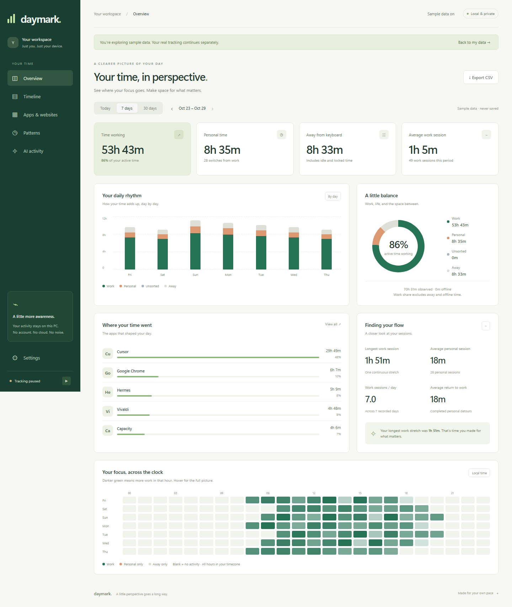

# Daymark

**Your time, in perspective.** A quiet, local-first Windows time tracker for understanding when you work, when you drift, and when you step away.



## Get started

Download **Daymark-win-x64.zip** from [Releases](https://github.com/HaiderHB/daymark/releases), extract it, and run `Daymark.exe`. Windows 10 version 2004+ or Windows 11, x64. The release includes its .NET runtime.

For a Start menu shortcut and automatic startup, run `install.ps1` from the extracted release:

```powershell
powershell -ExecutionPolicy Bypass -File .\install.ps1
```

This installs for your user in `%LOCALAPPDATA%\Programs\Daymark`. No administrator access required. Open the dashboard from the green tray icon or Start menu. The dashboard uses your browser; closing it leaves the tracker running.

This is an early, unsigned release. Windows may show an unknown-publisher warning. No automatic updater is included.

## What it tracks

- **Foreground applications**, sampled every five seconds. Adjacent matching samples are merged in SQLite.
- **Work, personal, and unsorted time.** App categories can be changed and apply to past reports. Explicit rules override automatic game detection.
- **AFK after a configurable grace period** (three minutes by default), backdated to the last input. Screen lock counts as away immediately; sleep or long sampling gaps are offline.
- **Foreground media activity**, when reported by Windows or the paired extension, can keep watching time active without mouse/keyboard input. Background music in another app does not keep your foreground app active.
- **Allowlisted website domains, per browser.** Chrome starts with `youtube.com` and `twitch.tv`. No URL paths, query strings, or full browsing history are read by the extension.
- **Vivaldi tab titles and Cursor project context.** Per-app title capture is enabled for these two requested apps and can be disabled independently in Settings. This uses the foreground window title, including Vivaldi tabs outside the website-domain allowlist. Titles can contain document, conversation and file names. Cursor project grouping is inferred from its title format.
- **AI task lifecycle activity**, separate from human work time: Claude Code/Codex hooks and experimental ChatGPT/Claude browser generation-control detection. Concurrent AI tasks count once for overall coverage.

The included work presets are Claude, ChatGPT/GPT, Vivaldi, Cursor, Capacity, Linear, and Hermes. Chrome and Steam are Personal. Games in Steam, Epic, Riot, and Xbox installation folders default to Personal. Other apps start Unsorted; use the dashboard to classify unfamiliar process names or games installed elsewhere.

## The dashboard

- Today, 7-day, and 30-day reports, with navigation to previous periods.
- Work/personal/away breakdowns, hourly and daily stacked charts, and a focus heatmap.
- A session timeline showing when categories changed and how long each stretch lasted.
- Average and longest work sessions, average personal sessions, sessions per recorded day, and completed personal detours between work sessions.
- Local CSV export and an explicitly labelled, in-memory sample-data mode.
- Startup, AFK/media preferences, custom app rules, browser allowlists, pause/resume, and history deletion.

**Definitions:** A session is contiguous activity in one category, including changes between apps in that category. AFK, offline, pauses, and unsorted activity break work/personal sessions. A work-to-personal switch counts as an interruption; average return time uses only completed work → personal → work detours. Averages use days with observed active time, so missing days are not counted as zero. Website time is included within browser time, never added twice. Work percentage excludes away and offline time.

## Browser extension

Chrome, Vivaldi, Edge and Brave are supported through a Manifest V3 extension. The extension is included in the release and in [`extension/`](extension/).

1. Open your browser's extensions page (for Chrome: `chrome://extensions`). Enable **Developer mode**.
2. Choose **Load unpacked** and select Daymark's `extension` folder. If installed, use `%LOCALAPPDATA%\Programs\Daymark\extension`.
3. Open the extension options, select the correct browser, and paste the **browser pairing key** from Daymark → Settings.
4. Click **Connect**, then **Grant allowed sites**. Reload any already-open allowed tabs.
5. After adding sites in Daymark, connect again and grant those sites in the extension.

The extension requests website access only when you grant specific allowlisted hosts. It does not request `tabs` or `history` permissions. It reports the canonical allowed domain, foreground status and media playback only; non-allowlisted hostnames are dropped before transmission and again at the desktop API. Site removals take effect at the desktop immediately; existing history is preserved. Unused browser host grants can also be removed in the browser's extension settings.

## Privacy and storage

Everything is stored in `%LOCALAPPDATA%\Daymark`:

- `activity.db`: UTC activity intervals, process names, allowed domains and state flags.
- `settings.json`: category rules, preferences and per-install pairing/access keys.
- `errors.log`: bounded local error diagnostics, if needed.

No accounts, cloud sync, telemetry, screenshots, keystroke content, AI prompt/response contents, or external dashboard resources. Window titles are captured only for enabled Vivaldi/Cursor rules. Settings and history are not encrypted at rest; they inherit your Windows user-folder permissions. Back up this folder with Daymark quit. Tracking history is retained until you erase it.

The local server binds **only `127.0.0.1:43127`**. API calls require a random bearer key; foreign website origins are rejected. The browser key only grants allowlist reads and activity submission, not history access or settings changes. The dashboard key is passed in a URL fragment, moved to session storage, then removed from the address bar. Do not share either key.

## AI activity

Run `install-ai-hooks.ps1` from the installed/release folder to add event reporters to Claude Code's `~/.claude/settings.json` and Codex's `~/.codex/hooks.json`. Existing unrelated hooks are preserved and timestamped backups are made. Restart your coding sessions afterward. **Codex requires you to review and trust these hooks in its hooks UI**; the installer does not bypass trust or change agent permissions. Run the same script with `-Remove` to remove Daymark's hooks.

The hook reporter discards prompt, answer, tool arguments and transcript paths. It sends a provider, hashed session ID, project folder basename and state to the local tracker. It returns empty JSON and never instructs the agent to continue, stop, or change its work. A separate restricted key authorizes hook submissions only.

The AI dashboard shows time with at least one running signal, overlap with your work, work without a running signal, and running/waiting/idle/unknown states. This is **task lifecycle**, not exact model compute time. Hook signals expire to Unknown after 30 minutes without a new lifecycle event; browser signals expire after 90 seconds. Pausing, quitting and suspend clear live state. Restarted/missing integrations do not imply confirmed idle.

For web chats, enable browser AI indicators, reconnect the extension and grant `chatgpt.com` / `claude.ai`. The extension inspects only generation/composer controls, including in background tabs; it does not collect prompts or answers. This is experimental: UI changes, localization, background throttling, and suspended tabs can cause missing or incorrect signals. No live paid AI tasks are launched by the test suite.

**Ordinary Claude/ChatGPT desktop chat apps do not have a dependable prompt-running integration in this release.** Their foreground usage is still tracked. Codex and Claude Code sessions use hooks wherever the hosting surface supports and permits those hooks; no claim is made that ordinary chat windows expose the same events.

Integration references: [Claude Code lifecycle hooks](https://code.claude.com/docs/en/hooks), [Codex lifecycle hooks and trust](https://learn.chatgpt.com/docs/hooks).

## Limitations

- App activity is an approximation of attention, not a measure of productivity. Reading/thinking can look idle; a video left playing can look active.
- Native media detection depends on apps exposing Windows media sessions. Windows reports playback by app, so media playing in a background tab of the foreground browser can keep it active. The extension adds foreground-tab media signals for granted hosts.
- Allowlisted domains are aggregated (including subdomains). No page/video-level tracking. No Firefox extension in this release.
- Five-second sampling can miss brief switches and approximate transition boundaries. Unexpected shutdown can lose the final sample. Unobserved gaps while Daymark is closed stay unrecorded.
- Very long sampling gaps are excluded as offline, whether caused by sleep or a delayed process. Lock/suspend events have automated engine coverage; a full unattended overnight test is still useful before relying on long-term totals.
- One local Windows user/session and one instance per port. No cross-device sync or multi-browser-profile attribution.
- Package download size includes .NET. Only one tray process runs in the background; the browser dashboard consumes resources only while open. See [architecture](docs/ARCHITECTURE.md) for details.

## Develop

Requires the .NET 10 SDK and Node.js 24+ for tests/formatting. Node and npm are **not** needed to run Daymark.

```powershell
dotnet build src/Daymark -c Release
dotnet run --project src/Daymark

dotnet test tests/Daymark.Tests -c Release
npm ci
npm test
npx playwright install chromium
npm run test:ui
npm run test:extension

./scripts/build.ps1
```

`build.ps1` produces `artifacts/Daymark-win-x64.zip`. Pass `-Dotnet <path>` to use a local SDK. UI smoke tests launch an isolated paused instance on port 43128 and a headless browser; they never change the normal instance's history or startup setting. Build before running the UI tests after source changes.

The initial release passed 16 .NET tests, 16 Node tests, a real-server dashboard/hook smoke test, an MV3 extension fixture test, and installer preservation/idempotency checks on Windows. The extension fixture verifies its pipeline against simulated generation controls; it is not a guarantee that live AI websites retain those controls. The self-contained release also passed the dashboard smoke test. A short 20-second background sample on the development PC measured 79 MB working set, 15.4 MB private memory, and 0.31% of one CPU core. This is an observation, not a cross-device resource guarantee.

A Windows Actions workflow is provided at [`docs/ci-windows.yml`](docs/ci-windows.yml). Move it to `.github/workflows/ci.yml` using a GitHub credential with workflow permission to enable hosted CI. The publishing credential for the initial release could publish source and releases but not register workflows; checks above were run locally.

Useful development arguments: `--background`, `--no-track`, `--data-dir <folder>`, and `--port <number>`. Alternate ports are for testing; the shipped browser extension uses 43127.

## Why a new implementation?

[ActivityWatch](https://github.com/ActivityWatch/activitywatch) was evaluated and is an excellent, mature alternative. Its modular watchers, cross-platform capabilities, and broader collection are useful if that is what you need. Daymark is a fresh Windows-only implementation optimized around one tray process, no always-running browser renderer, strict website allowlists, and a dashboard focused on work/distraction patterns. No ActivityWatch source is copied or forked.

## Uninstall

Quit Daymark from the tray, then run the release's `uninstall.ps1`. It removes the installed app, startup registration and shortcut, but preserves your data. Remove the extension separately. To erase local history too, use Settings → Erase tracking history or remove `%LOCALAPPDATA%\Daymark` after quitting.

## License

MIT. Dependencies retain their respective licenses. See [LICENSE](LICENSE).
